# NULL

> **一个在设备上运行小语言模型的安卓应用：界面是改造过的 chat-demo 网页，原生只留模型、设置、关于三页，以及让它的说法保持诚实的那些检查。**

## 功能

- **完全在手机上运行**：模型下载完成之后断网也能用，对话不出设备
- **对话与历史**：流式回复、重新生成、续写、编辑提问、版本切换；对话内搜索、跨对话搜索
  （标题与正文）、置顶 / 归档、重命名、单条或一组问答删除、分享整段或 Markdown 导出
- **多模态**：图片交给设备上的视觉模型；语音输入交给系统识别器（离线优先）；
  朗读交给系统 TTS。音频与图片都不出手机
- **模型**：目录 12 档，每档标「多模态」或「纯文本」；其中 6 档能看图（InternVL3.5 1B/2B、
  MiniCPM-V 4.7 1B、MiniCPM-V 4、Ovis2.5 2B 等），其余是更快更省内存的文本模型。
  下载可续传并按摘要校验，也从文件导入、删除；跑分给出首 token、预填与解码速度，
  结果按模型存下来并排在一起，两个模型才有得比
- **前端是 chat-demo**：DeepSeek 开源的聊天界面（MIT）就地改造为全本地，对话、历史、多模态都在它里面；原生 Compose 只保留它做不了的界面
- **不收集任何数据**：没有分析、没有崩溃上报、没有账号；隐私契约由脚本强制执行

## 截图

<p align="center"></p>

### 对话（网页前端）

| 新对话 | 一轮回答 |
| --- | --- |
| 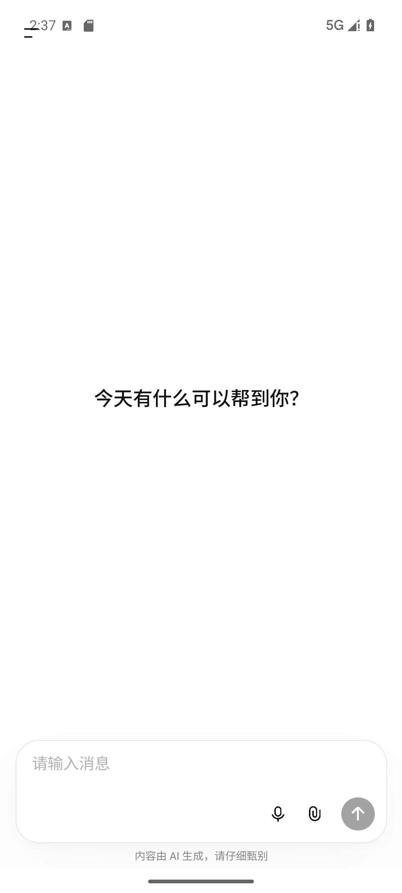 | 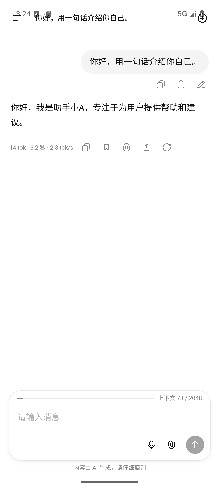 |

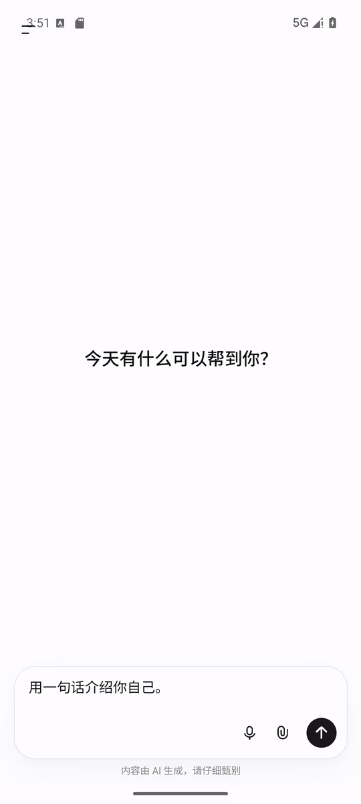

<sub>gif 以 2× 速度播放；这是模拟器上的实测，真机快得多。</sub>

这套界面来自 DeepSeek 开源的 [chat-demo](https://github.com/deepseek-ai/chat-demo)（MIT），
在 `web/` 里改造为全本地：回复由设备上已经加载的 LiteRT-LM 引擎生成，前端不发一个网络请求。

传输层（`web/src/services/api/local.ts`）把请求交给 Android 侧的 JS 桥，桥把引擎的增量
翻译回与云端完全相同的流式事件；配色从蓝色改成黑白灰；界面默认中文。云端能力按「能本地
就本地，改不成才去掉」处理：

| 云端原型里的能力 | 这台设备上的做法 |
| --- | --- |
| 回复朗读 | 系统 `TextToSpeech`，离线 |
| 位置信息 | 本机模式下不出现：云端把它放进请求上下文，本机的系统提示词在加载模型时就用掉了，请求期没有位置可走 |
| 图片附件 | 字节不出进程，交给设备上的视觉模型 |
| 语音输入 | 系统 `SpeechRecognizer`，请求带 `EXTRA_PREFER_OFFLINE` |
| 联网搜索 | 需要云端检索，本机模式不出现 |
| PDF / Office 附件 | 版面解析本机没有等价物，选择器直接说明并拒绝 |

其余 UI 代码原样保留。

### 多模态（本机）

| 看图 | 语音输入 |
| --- | --- |
| 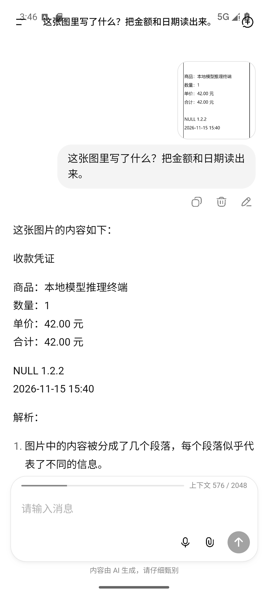 | 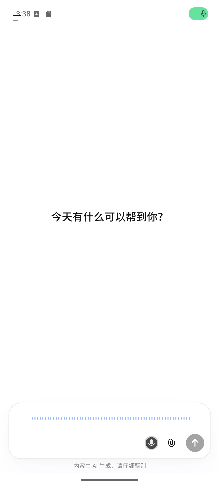 |

前端的附件入口保留下来了，只是换了后端：图片不进 Files API，字节留在页面内存里，
发送时经 JS 桥交给设备上的视觉模型（[InternVL3.5-2B](https://huggingface.co/litert-community/InternVL3_5-2B)，
1.5 GB，Apache-2.0）。识别器、TTS、剪贴板都是系统能力，没有一个字离开手机。

**这三件事都有边界，写在这里而不是藏着：**

- 视觉精度取决于模型。上图那张凭证，商品、数量、单价、合计 42.00 元 和日期都读了出来；
  换一张更糊的照片，同一档模型也会说「画面看不清」——2B 是这样，12B 也是，差别在程度。
- 语音输入走系统的 `SpeechRecognizer`，请求带 `EXTRA_PREFER_OFFLINE`。**设备没有离线识别器
  时会如实报错，不会退回云端**；模拟器就是这种设备，所以这一项只能在真机上看到转写结果。
- 文档（PDF / Office）仍然拒收：版面解析在本机没有等价物，界面会直接说明，而不是上传。
- 粘贴图片走原生剪贴板。WebView 没有给页面可申请的 `clipboard-read` 资源，
  `navigator.clipboard.read()` 在页面里必定被拒，所以由应用读、再把字节推给页面。

### 管理界面（Compose，只剩 NULL 独有的部分）

对话与历史都由页面负责，原生这边只保留 chat-demo 做不了的界面：模型管理
（下载/校验/加载与切换/跑分与跨模型对比/删除）、设置（后端、采样、系统提示词、提示词库、应用锁）、
关于（许可证、诊断、擦除）。这三页从页面设置里的三行打开，返回即回到对话。

会话本身不住在这里：页面的会话文档经桥写进 `files/web-history/`，用 `FileCipher`
加密，删除走 `SecureDelete`；附件原件仍留在页面的 IndexedDB（未加密，已在上文标明）。

| 模型管理 | 摘要校验 |
| --- | --- |
| 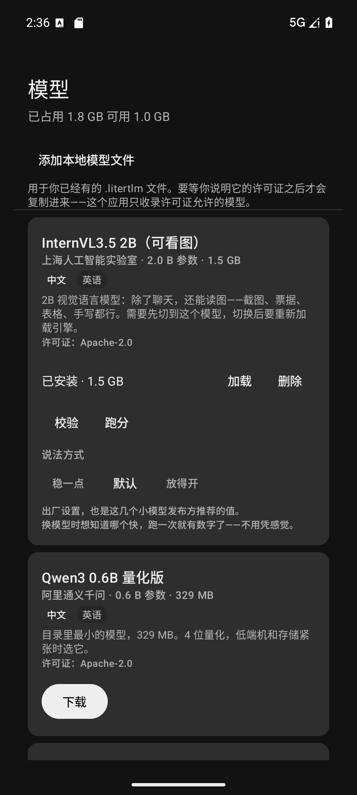 | 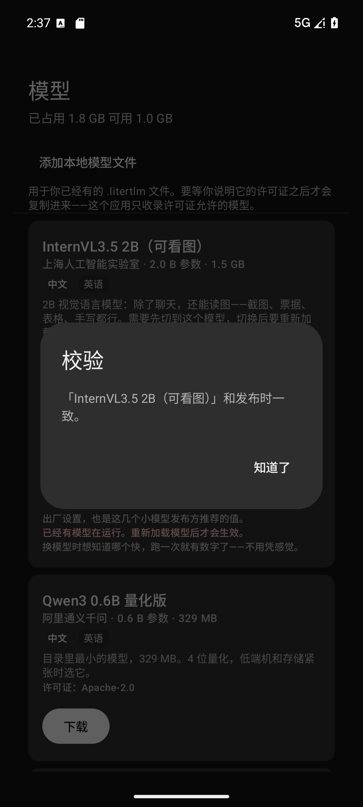 |

模型卡片上的「加载」就是切换：加载之后就由它回答，卡片上会标「使用中」。同一行右边的
「删除」删的是文件，两者互不影响。


| 设置 | 运行在 / 提示词 / 回答 | 深色设置 |
| --- | --- | --- |
| 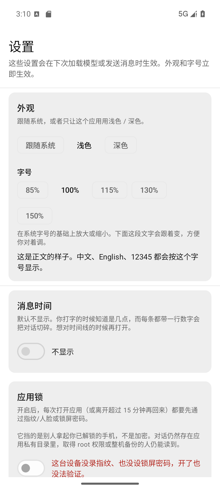 | 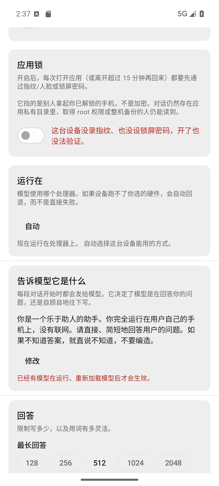 | 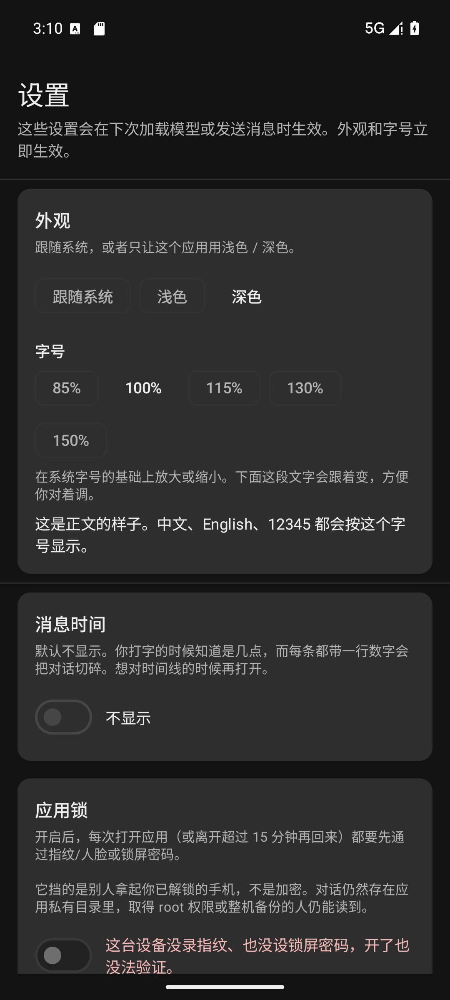 |

| 关于 |
| --- |
| 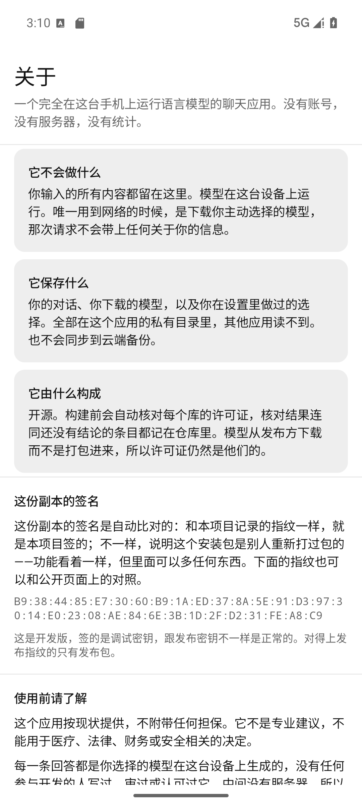 |

> 所有截图取自仓库自身的 debug 构建（「关于」页因此显示开发版签名），跑在 Android 16 x86_64
> 模拟器上。模拟器不提供 OpenCL，GPU delegate 初始化失败后自动退回 CPU —— 设置页那句
> 「现在运行在处理器上」与日志（`OpenCL not supported on this platform` →
> `Failed to initialize WebGPU environment: INTERNAL: No adapters found`）说的是同一件事。
> 对话截图里的速度读数是那台模拟器的实测值；真机快得多，这个数字不代表上限。
>
> 缺两张：**跑分**的对比卡片，和**应用锁的锁屏**（开关打开后重启，界面停在模型加载态，
> 没能验证到锁屏）。

## 环境要求

| 工具 | 本项目使用的版本 |
| --- | --- |
| JDK | 17（Gradle 工具链） |
| Android SDK Platform | 37.2（`compileSdk` 37.2 / `targetSdk` 37） |
| 最低 Android 版本 | 26（`minSdk`） |
| Gradle | 9.1.0 |
| Android Gradle Plugin | 9.0.1 |
| Kotlin | 2.4.21 |

## 构建

```bash
git clone https://github.com/KAYOYAK/NULL.git
cd DemoApp

# 告诉 Gradle 你的 SDK 在哪里。这个文件是本机专用的，已加入 gitignore。
echo "sdk.dir=$ANDROID_HOME" > local.properties

# 调试构建
./gradlew assembleDebug

# 单元测试
./gradlew testDebugUnitTest

# Lint
./gradlew lintDebug
```

调试 APK 会生成在 `app/build/outputs/apk/debug/app-debug.apk`。

**前端是打进 APK 的网页**：改过 `web/` 之后必须重新构建并同步进 assets，否则装出来的还是旧页面。

```bash
cd web
pnpm install
pnpm run build:local        # 跨平台；上游的 `pnpm build` 用 rm -rf，Windows 上会失败
# 删掉 app/src/main/assets/web 再整目录复制 web/dist 过去
cd ..
./gradlew assembleDebug
```

Windows 上把 `./gradlew` 换成 `gradlew.bat`。

### 仪器化测试

它们需要一台设备或模拟器，而且设备上要有一个模型。下面这个脚本跑完之后不会把模型弄丢：

```powershell
./scripts/run-instrumented-test.ps1
./scripts/run-instrumented-test.ps1 -Class com.kayoyak.demoapp.inference.LiteRtLlmEngineTest
./scripts/run-instrumented-test.ps1 -ModelPath D:\path\to\another.litertlm
```

`gradlew connectedDebugAndroidTest` 是 Gradle 自带的那条路，它跑完会卸载应用 —— 应用私有目录里的模型也跟着一起没掉，所以那条路没法在不重新推一次模型的情况下跑第二遍。这个脚本直接驱动同一套 instrumentation：构建、安装两个 APK 且不卸载、先启动一次应用（它的 `filesDir` 是懒创建的）、如果模型还不在就复制一个进去，然后对你指定的测试类跑 `am instrument`。

引擎测试先看应用自己的 `files/models` 目录，找不到就退回 `/data/local/tmp/models` 里的任意 `*.litertlm` 文件，所以手动放进去一个模型就够了：

```bash
adb shell mkdir -p /data/local/tmp/models
adb push Qwen3-0.6B_dynamic_wi4b32_afp32.litertlm /data/local/tmp/models/
```

找不到模型的测试会说明这一点然后返回，而不是失败；它打印的提示会写清用的是哪个文件。

没有流水线跑这一组测试。一个测试全部被跳过的模拟器任务，和一个测试全部通过的任务，报的都是绿色；而目录里最小的模型是 344 MB —— 所以当初的选择是：一个不可能诚实地失败的任务，或者干脆没有任务。

### 发布构建

发布签名是**故意**不配置在这个仓库里的。在本地提供你自己的 keystore，不要把它提交上去：

```bash
./gradlew assembleRelease \
  -Pandroid.injected.signing.store.file=/path/to/release.jks \
  -Pandroid.injected.signing.store.password="$STORE_PASSWORD" \
  -Pandroid.injected.signing.key.alias="$KEY_ALIAS" \
  -Pandroid.injected.signing.key.password="$KEY_PASSWORD"
```

绝不要提交 `.jks` 文件或它的密码。丢掉 keystore 意味着你再也无法给已经上架的应用发更新 —— 签名身份是换不掉的。

## 项目结构

```
web/                        前端源码（chat-demo 的改造版：React + Rspack）
app/src/main/assets/web/    构建后的网页（必须提交，AGP 要它才打得出 APK）
app/src/main/java/...       原生源码（Jetpack Compose：模型 / 设置 / 关于）
app/src/main/res/       资源：字符串、主题、drawable、图标
app/src/test/           JVM 单元测试，由 `testDebugUnitTest` 运行
app/src/androidTest/    仪器化测试，需要设备或模拟器
gradle/libs.versions.toml   依赖版本的唯一来源
```

## 隐私

这个应用什么都不收集。没有分析、没有崩溃上报、没有遥测，也没有账号。网络只用来下载模型，别的什么都不做；模型到了设备上之后，把网络关掉它照样工作。

完整细节，以及让这些说法保持为真的那些检查：[PRIVACY.md](PRIVACY.md)。

前端（chat-demo 的页面）的会话不写 IndexedDB：会话文档经 JS 桥交给原生侧，
用应用自己的 `FileCipher` 加密后才落盘，删除走 `SecureDelete`。附件原件
（图片等）仍是页面侧的 IndexedDB —— 这一点没有加密，写在这里以免被误解成全部加密。

文件头是 `NULL` 魔数加版本号，随后是密文；`grep` 不到任何明文字段。

## 项目原则

三条约束不可谈判，并且约束每一次改动 —— 法律、隐私、开源可验证性。每一条都由一个会让构建失败的脚本强制执行，而不是靠文档里的一句承诺。

**[docs/PRINCIPLES.md](docs/PRINCIPLES.md)**

| 约束 | 由谁执行 |
| --- | --- |
| 许可证 | `scripts/check-licenses.ps1` |
| 隐私契约 | `scripts/check-privacy.ps1` |
| 打进发布 AAR 里的第三方声明 | `scripts/check-embedded-notices.ps1` |
| 法律声明与署名 | `scripts/check-legal-docs.ps1` |
| 文案集中在一处，并使用应用的语言 | `scripts/check-ui-copy.ps1` |
| README 与代码一致（版本号、截图、门禁名字） | `scripts/check-readme.ps1` |
| 每个屏幕回调都在代码里接上了 | `scripts/check-ui-wiring.ps1` |
| 改过词的功能没有留下废弃文案 | `scripts/check-unused-strings.ps1` |
| 署名准确 | `.github/workflows/compliance.yml` |

## 语言

**这个应用是中文的，面向中文使用者。** 原生界面的文案在 `app/src/main/res/values/strings.xml`；网页前端有自己的一份 `web/src/i18n/zh.ts`（和 `en.ts`，因为 chat-demo 上游就是双语的），本机模式下默认 `zh-CN`。目录提供的每一个模型都是能进行中文对话的。

最后这一条是正确性要求，不是偏好：一个不会中文的模型摆在最上面，中文问题回来的是一本正经的英文，那读起来像应用坏了，而不是「模型选错了」。所以每个条目都记录它能用什么语言对话、列表会显示出来，`ModelCatalogue.validate()` 会拒绝第一个（默认）模型不会中文的目录。

**目录里只放中文模型。** 别处发布的模型可能很优秀，但在这里仍然是错误的选择：它可能不能进行中文对话，它的主机可能在中国大陆不可达，它的发布者对它在那边能不能用毫无利害关系。`validate()` 同样会拒绝第一个下载源是 `huggingface.co` 的目录，应用也出于同样的原因先试镜像。列表从 329 MB 起步，这样存储吃紧的设备也能用这个应用。

源码注释保持英文 —— 这是代码库的约定，也是外部贡献者读的东西；这份 README 用中文，因为它是给使用者看的。这是关于贡献者的决定，不是关于使用者的决定。

## 它能做什么

和一个完全跑在手机上的模型进行文字对话。

- **模型。** 下载、从文件导入、删除。下载可续传，并按记录的摘要校验；先试镜像，因为这个应用面向的那个国家里，发布者的主机是被墙的。
- **对话。** 流式回复、中途停止、重新生成回答、删除一条消息或一整轮对话、编辑最后一个问题再问一遍。代码块、标题、列表、引用和行内强调都会渲染；一条回复可以整条复制，也可以一次只复制一个代码块。每条消息都带发送时间，回复带它花了多久、每秒多少 token —— 这才让两个模型可比。
- **对话内搜索。** 长回复正是「想再把某个词找出来」变得重要的场合。匹配数量会显示出来，所以一段被截短的记录永远不会读起来像丢了消息。
- **历史。** 跨标题和消息正文搜索、重命名、删除、置顶；会话文档加密落盘（见「隐私」），导出与导入走页面的备份入口。
- **备份。** 把所有对话导出成一个文件保存，也可以再导入回来。这个应用把一切都留在本地，也声明不做云备份，所以这是对话能活过换手机的唯一方式：「不同步」不能等于「搬不走」，否则隐私就变成了笼子。
- **从别的应用分享进来的文字。** 在这里分享一段文字，它会进到输入框里等你编辑再发。它不会被自动发送 —— 发不发仍然是用户的动作。
- **设置。** 用哪个处理器、系统提示词、回复长度、temperature、浅色/深色/跟随系统外观，以及文字大小。内置五条指令作为起点，你自己的措辞可以起个名字保存下来复用 —— 凭记忆复现一条好指令，是没人会做的事。
- **关于。** 什么在跑、什么不会离开设备、以及怎么把一切抹掉。

## 免责声明与条款

这个应用在你的设备上跑一个语言模型，把它说的话显示给你。没有人审过那些输出，中间也没有服务器可以审 —— 让你的对话保持私密的那个性质，同时也意味着这里没有任何东西可以被审核。

**它不是专业建议，绝不能用它做医疗、法律、财务或安全方面的决定。** 它跑的模型小到能装进手机，会很有把握地说错话。

- **[DISCLAIMER.md](DISCLAIMER.md)** —— 担保、责任、输出是什么，以及你要为什么负责。
- **[docs/legal/TRADEMARKS-AND-CLAIMS.md](docs/legal/TRADEMARKS-AND-CLAIMS.md)** —— 与任何模型发布者无关联、本项目指名提到的商标、它不分发什么，以及怎么提出侵权主张。

这两份文件都由 `scripts/check-legal-docs.ps1` 强制：任何一份缺失、没有被链接，或者不再为目录里点名的发布者署名，构建就会失败 —— 如果应用自己不再显示免责声明，也会失败。应用会离线显示一份，在**模型 → 关于**里，因为挂在网站上的文档，从它描述的那台设备上是够不到的。

## 参与贡献

欢迎报告问题和提交 PR。见 [CONTRIBUTING.md](CONTRIBUTING.md)。
安全问题请按 [SECURITY.md](SECURITY.md) 里说的私下报告。

## 许可证

[Apache-2.0](LICENSE) © 2026 Shizhou Xu

[](https://github.com/KAYOYAK/NULL/actions/workflows/ci.yml)

## 已经做了什么，接下来做什么

[docs/ROADMAP.md](docs/ROADMAP.md) 列出了这个项目决定要做的、决定不做的、以及还没决定的每一项 —— 一行一项，并写明它基于什么。
